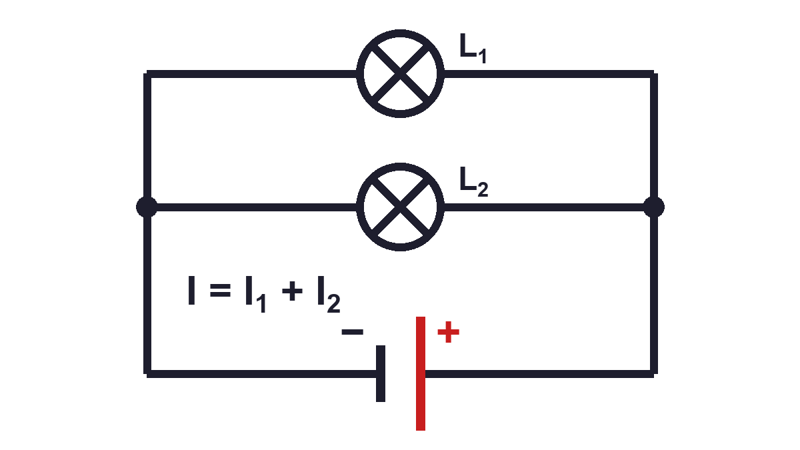

# kahoot-creator

A Claude Code skill that designs a Kahoot quiz with the teacher, then builds it in the Kahoot web editor: questions, answers, timers, illustrations, private visibility, filing into a folder, and a final check.

First version. It will be updated as it gets used, and its content may still change. The skill comes in English (the default) and in French (the original, in `fr/`). The English version is a translation: the author uses the French one, and the English one has not been run yet. Both have only been tested with the French Kahoot interface.

## Requirements

- Claude Code with the Claude in Chrome extension connected to Chrome or Edge (`mcp__claude-in-chrome__*` tools).
- A Kahoot account. The teacher signs in; the skill never types a password.
- The Kahoot interface set to French: the skill's helpers find buttons by their French labels.
- Python with Pillow for the two illustration scripts, and PyMuPDF if the course material is a PDF to extract.
- The `anthropic-skills:chrome-browser` skill, which this skill loads before driving the browser, and `anthropic-skills:xlsx` for the spreadsheet import.

## Installation

Copy the `kahoot-creator` folder into your skills:

```bash
git clone https://github.com/StashWorkshop/kahoot-creator-skill.git
cp -r kahoot-creator-skill/kahoot-creator ~/.claude/skills/
```

For the French version, copy `kahoot-creator-skill/fr/kahoot-creator` instead. Install only one of the two: they share the same skill name.

## Usage

Ask, for example: "Prepare a 10-question Kahoot on series and parallel circuits from this PDF."

The skill asks a few questions (topic, class, number and types of questions, image sources), then shows a table with each question, its answers, its timer and its illustration. Nothing is typed into Kahoot until this table is approved. The calculations behind correct answers and distractors are run in Python before they are proposed. The quiz is then built on a blank canvas, set to private, filed, and read back on its detail page. The skill does not start a game and does not share anything.

Settings for each class (level, Kahoot folder, timers) are kept in `~/.claude/kahoot-preferences.json`. This file is optional: the skill creates it at the end of the first use, and its format is given in `SKILL.md`.

Two scripts produce illustrations. `scripts/circuit_schema.py` draws a circuit diagram (lamp, resistor, motor, LED, in series or in parallel) on a transparent background. `scripts/formula_card.py` adds formulas to an image or makes an image from formulas alone.



*Produced by `python kahoot-creator/scripts/circuit_schema.py --top "L:L_1" --mid "L:L_2" --formula "I = I_1 + I_2" --out schema.png`, shown here on a white background.*

## Known limits

- The steps described in `references/kahoot-editor.md` come from one real quiz built in Edge. The Kahoot editor may change, and the coordinates given are only landmarks.
- The JavaScript helpers have not been tested on puzzle questions.
- The spreadsheet import, planned for quizzes of 15 questions or more, has not been tested yet.
- Some question types depend on the Kahoot plan. If the editor blocks one, the skill replaces it with a quiz question and says so.
- `circuit_schema.py` loads the Arial font from `C:/Windows/Fonts`, so it only runs on Windows as it is. `formula_card.py` has a fallback font.

## License

MIT. See the `LICENSE` file.
